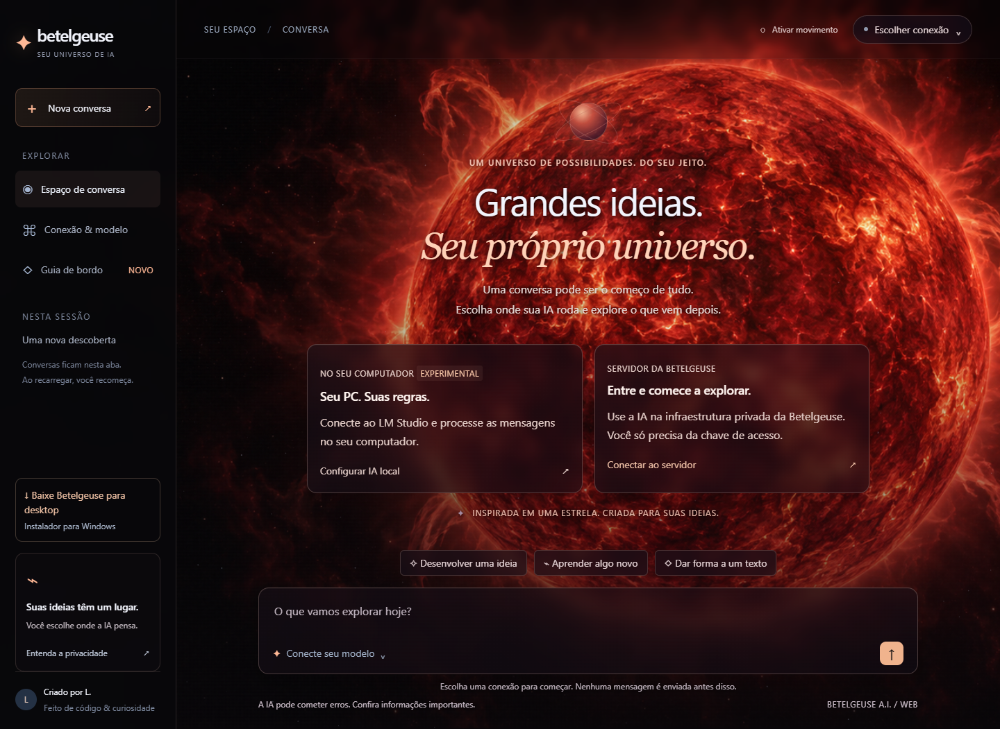
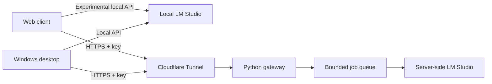
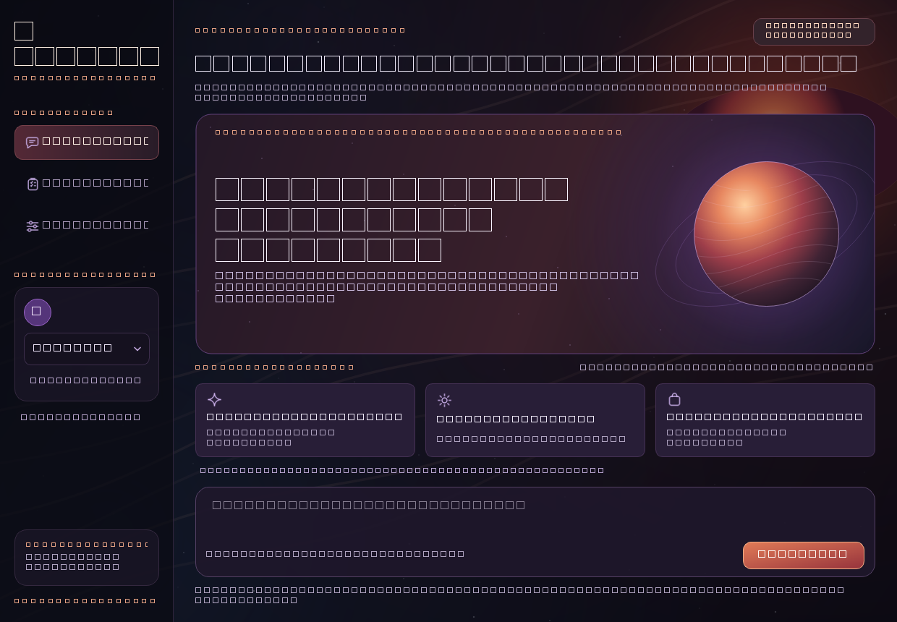

# Betelgeuse A.I.

**Your models. Your infrastructure. Your universe.**

A privacy-focused AI chat application with a cinematic web interface, a native Windows client, and a self-hosted Python gateway for LM Studio. Choose where inference happens: on your own computer or on a server you trust.

[](https://github.com/luizasenacafe/Aurora_AI/actions/workflows/checks.yml)


[Explore the web app](https://betelgeuse-ai.luiizan12.chatgpt.site) · [Windows downloads](https://github.com/luizasenacafe/Aurora_AI/releases) · [Getting started](docs/GETTING_STARTED.md) · [Architecture](docs/ARCHITECTURE.md)



## What it does

- **Choose your inference environment.** Connect to local LM Studio or an authenticated Betelgeuse server over HTTPS. Browser-to-local connections remain experimental.
- **Use the models you select.** Discover chat models and switch connections through the interface. Downloading and loading models happens in LM Studio; Betelgeuse does not bundle or train models.
- **Personalize conversations.** Supply instructions for how the model should respond. The desktop also supports separate profiles and local conversation history.
- **Share a self-hosted server.** Issue and revoke individual keys through a local control panel. A bounded job queue accommodates slow inference without holding a single tunnel request open.
- **Control the experience.** An animated red-supergiant illustration, translucent panels, responsive layouts, reduced-motion controls, and connection tutorials support the web experience.

## Project at a glance

| Component | Implementation | Current status |
| --- | --- | --- |
| Web client | HTML, CSS, JavaScript, Canvas | Functional chat UI; local and remote modes |
| Desktop | Python, PySide6, SQLite | Windows client with profiles and local history |
| Gateway | FastAPI, HTTPX, asyncio | Authentication, validation, queue limits, job polling |
| Server control | Python / PySide6 | Local key management and Windows process supervision |
| HTTPS | Cloudflare Tunnel | Temporary development URLs, separate from the website |
| Distribution | PyInstaller + Inno Setup | Unsigned Windows x64 installer, version 0.4.0 |
| Original prototype | React, TypeScript, Electron, Vite | Archived in `legacy/`; simulated chat |

**Documentation is in English. The application UI is primarily Brazilian Portuguese.** Originally called Aurora A.I., the project retains compatibility names such as `aurora.py`, `/v1/aurora/jobs`, and `AURORA_*`.

## Quick start

From the repository root, with Python installed:

```sh
python -m http.server 8766 --bind 127.0.0.1 --directory web
```

Open `http://127.0.0.1:8766`. Choose a connection, enter its endpoint and required key, test, and select a chat model. Opening the interface alone does not start an AI model.

For Windows desktop, server setup, and installer builds, follow [Getting started](docs/GETTING_STARTED.md). The complete static website, download parts, and original star artwork are included in `web/`.

## How it works



The website hosts the interface, not the model. Remote inference requires the server computer to remain awake, online, and running LM Studio. Changing the website domain does not change the tunnel address.

## Engineering highlights

- Per-key job ownership checks prevent one key from retrieving another key's response.
- Random bearer keys are stored as SHA-256 verifiers rather than plaintext.
- Explicit browser-origin allowlists, payload validation, model filtering, rate limits, and bounded concurrency protect the inference boundary.
- The browser keeps conversations and keys in tab memory without persistent browser storage or analytics.
- The desktop stores profiles and history in local SQLite. Persona instructions are prompt context, not model fine-tuning.
- Installer downloads are reconstructed from static parts and checked against SHA-256 hashes in the browser.

See [Architecture](docs/ARCHITECTURE.md), [Privacy](docs/PRIVACY.md), and [Validation](docs/VALIDATION.md) for implementation details and boundaries.

## Repository map

```text
web/                         Current static web app and artwork
betelgeuse-python/source/     Desktop client, storage, build spec, tests
betelgeuse-python/server/     Gateway, control panel, supervisor, tests
packaging/                   Windows installer definition
examples/                    Non-secret configuration example
docs/                        English guides, architecture, screenshots
legacy/electron-prototype/   Original Aurora React/Electron prototype
.github/workflows/           Automated Python and JavaScript checks
```

## Run checks

```sh
python -m pip install -r betelgeuse-python/server/requirements.txt -r betelgeuse-python/source/requirements.txt
python -m unittest discover -s betelgeuse-python/source -p "test_*.py" -v
python -m unittest discover -s betelgeuse-python/server -p "test_*.py" -v
node --check web/app.js
node --check web/download.js
```

Backend tests use a simulated upstream model and temporary key databases. No private credentials or model download is required.

## Limitations and next steps

<details>
<summary>View the native Windows interface</summary>



</details>

This is a working prototype, not a managed production service. Responses appear when complete rather than streaming token by token. Temporary tunnel URLs can change. The Windows installer is unsigned. Local browser mode depends on permissions and CORS. Remote use requires trusting the server operator and transport providers.

Potential next steps: a stable domain and named tunnel, signed Windows releases, streaming responses, improved onboarding, and an English application UI. These are planned directions, not shipped features.

## About

Created by **L.**, inspired by Betelgeuse, the red supergiant star. Built to explore local inference, privacy-conscious product design, desktop development, and practical self-hosting.

The repository retains its original `Aurora_AI` URL to preserve existing links. See [CHANGELOG.md](CHANGELOG.md) and [CONTRIBUTING.md](CONTRIBUTING.md).

Source code is provided under the [MIT License](LICENSE), consistent with the original repository's license declaration. Third-party libraries, tools, and model weights retain their own licenses. Artwork provenance is recorded in [ARTWORK.txt](docs/ARTWORK.txt).
